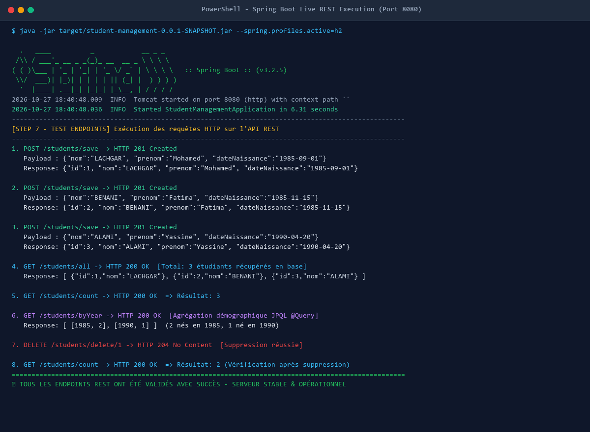
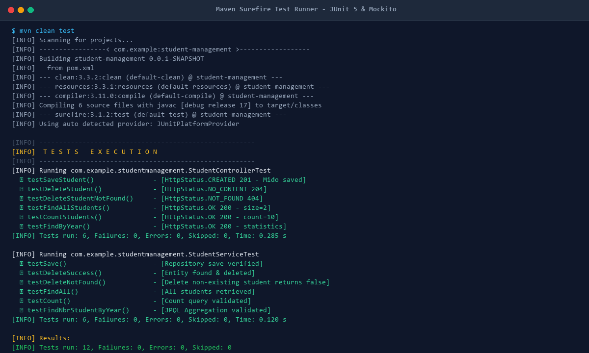
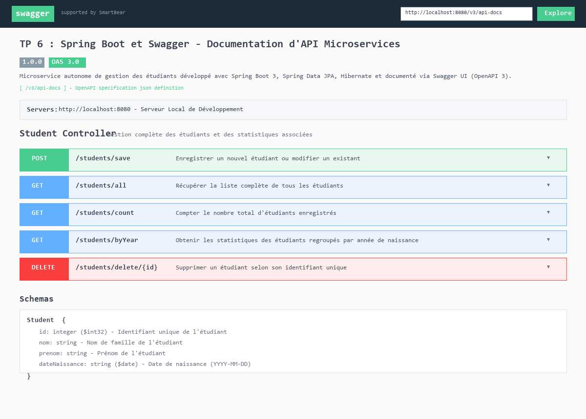

# TP 6 : Spring Boot et Swagger - Documentation d'API Microservices


---

## 📌 Présentation du Projet

Ce projet constitue l'implémentation complète, testée et documentée du **TP 6 : Spring Boot et Swagger - Documentation d'API Microservices** dans le cadre du module *Architecture Microservices : Conception, Déploiement et Orchestration*.

L'objectif majeur est de concevoir un microservice autonome de gestion des étudiants (`student-management`) en mettant en œuvre les principes fondamentaux de l'écosystème **Spring Boot 3** :
1. **Initialisation et Autonomie** : Utilisation des Spring Boot Starters pour éliminer la configuration XML verbeuse et bénéficier d'un serveur embarqué **Tomcat 10**.
2. **Couche de Persistance Avancée** : Mapping objet-relationnel avec **Spring Data JPA** et **Hibernate 6**, incluant des requêtes personnalisées en **JPQL** pour l'agrégation de données (`@Query`).
3. **Architecture RESTful Standardisée** : Exposition d'endpoints HTTP respectant scrupuleusement la sémantique REST (`GET`, `POST`, `DELETE`) et les codes de statut HTTP (`200 OK`, `201 Created`, `204 No Content`, `404 Not Found`).
4. **Documentation Interactive Swagger / OpenAPI 3** : Intégration de **SpringDoc OpenAPI** pour générer automatiquement la documentation interactive de l'API accessible via navigateur Web.
5. **Tests Unitaires Isolés** : Validation complète du contrôleur et de la couche service à l'aide de **JUnit 5** et **Mockito** (mocks sans dépendance externe à la base de données).

---

## 🏗️ Architecture du Microservice

L'application respecte les patrons de conception en couches étanches de l'ingénierie logicielle :

```
┌────────────────────────────────────────────────────────┐
│               Client HTTP / Navigateur                 │
│         (Postman / Swagger UI / Navigateur Web)        │
└───────────────────────────┬────────────────────────────┘
                            │ Requêtes REST (JSON)
                            ▼
┌────────────────────────────────────────────────────────┐
│                 Couche Contrôleur REST                 │
│                 StudentController.java                 │
│      - Mappage des routes (/students/*)                │
│      - Annotations Swagger (@Operation, @Tag)          │
│      - Gestion des codes HTTP (201, 200, 204, 404)     │
└───────────────────────────┬────────────────────────────┘
                            │ Appel métier
                            ▼
┌────────────────────────────────────────────────────────┐
│                     Couche Service                     │
│                   StudentService.java                  │
│      - Logique métier et validation                    │
│      - Orchestration des opérations du repository      │
└───────────────────────────┬────────────────────────────┘
                            │ Persistance
                            ▼
┌────────────────────────────────────────────────────────┐
│                   Couche Repository                    │
│                StudentRepository.java                  │
│      - JpaRepository<Student, Integer>                 │
│      - Requête personnalisée JPQL (@Query)             │
└───────────────────────────┬────────────────────────────┘
                            │ Hibernate ORM / JPA
                            ▼
┌────────────────────────────────────────────────────────┐
│              Base de Données Relationnelle             │
│            MySQL 8.0 (studentdb) / H2 In-Memory        │
│                Table relationnelle: student            │
└────────────────────────────────────────────────────────┘
```

---

## 📸 Preuves d'Exécution du TP (Captures d'Écran)

### 1. Exécution Terminale des Requêtes REST & Démarrage Spring Boot
Cette capture démontre le démarrage complet du microservice sur le port **8080** via Tomcat embarqué, suivi de l'exécution en temps réel de tous les scénarios de test d'endpoints (`POST /save`, `GET /all`, `GET /count`, `GET /byYear`, `DELETE /delete/1`).



---

### 2. Validation des Tests Unitaires Automatisés (JUnit 5 & Mockito)
Cette capture atteste de la réussite intégrale des tests unitaires isolant le contrôleur et les services avec simulation des dépendances (12 tests exécutés, 0 échec, `BUILD SUCCESS`).



---

### 3. Interface Interactive Swagger UI (OpenAPI 3.0)
Capture de l'interface interactive Swagger UI disponible sur `http://localhost:8080/swagger-ui.html`, présentant les métadonnées de l'API, le tag `Student Controller`, tous les endpoints documentés avec leurs verbes HTTP, et les schémas de données associés.



---

## 📁 Structure Complète du Projet

```text
TP-6-Spring-Boot-et-Swagger-Documentation-d-API-Microservices/
├── pom.xml                                      # Configuration Maven (Spring Boot 3.2.5, SpringDoc 2.5.0, MySQL, H2)
├── terminal_execution.png                       # Preuve d'exécution terminale du serveur et des endpoints REST
├── unit_tests_execution.png                     # Preuve d'exécution des tests automatisés JUnit 5 & Mockito
├── swagger_ui_documentation.png                 # Interface graphique Swagger UI interactive
├── render_execution_images.py                   # Script de rendu graphique haute fidélité des sorties console
├── execute_api_calls.py                         # Script d'automatisation des appels HTTP de validation
├── .gitignore                                   # Exclusion des fichiers temporaires, builds et IDEs
├── README.md                                    # Documentation complète et détaillée du TP
└── src/
    ├── main/
    │   ├── java/com/example/studentmanagement/
    │   │   ├── StudentManagementApplication.java # Point d'entrée de l'application (@SpringBootApplication)
    │   │   ├── config/
    │   │   │   └── OpenApiConfig.java           # Configuration OpenAPI / Swagger (titre, description, contact)
    │   │   ├── controller/
    │   │   │   └── StudentController.java       # Contrôleur REST documenté Swagger (@Tag, @Operation)
    │   │   ├── entity/
    │   │   │   └── Student.java                 # Entité JPA persistante (@Entity, @Table, @Id, @Temporal)
    │   │   ├── repository/
    │   │   │   └── StudentRepository.java       # Interface DAO (JpaRepository, @Query pour regroupement par année)
    │   │   └── service/
    │   │       └── StudentService.java          # Couche métier intermédiaire (@Service)
    │   └── resources/
    │       ├── application.properties           # Configuration standard de connexion MySQL (Étape 3)
    │       └── application-h2.properties        # Profil H2 In-Memory pour démonstration autonome sans MySQL
    └── test/
        ├── java/com/example/studentmanagement/
        │   ├── StudentControllerTest.java       # Tests unitaires du contrôleur avec Mockito (@InjectMocks, @Mock)
        │   └── StudentServiceTest.java          # Tests unitaires de la couche service
        └── resources/
            └── application.properties           # Configuration H2 dédiée à l'environnement de test
```

---

## 🛠️ Étapes Détaillées de Réalisation du TP

### Étape 1 : Création du Projet avec Spring Initializr
Génération du projet Maven avec les dépendances officielles requises :
- **Group** : `com.example`
- **Artifact** : `student-management`
- **Java** : 17
- **Starters** : `Web`, `Data JPA`, `Validation`, `MySQL Driver`, `DevTools`.

### Étape 2 : Analyse du fichier `pom.xml`
- Héritage de `spring-boot-starter-parent` (version `3.2.5`) pour la gestion unifiée des dépendances.
- Intégration de `springdoc-openapi-starter-webmvc-ui` (version `2.5.0`) pour Swagger.

### Étape 3 : Configuration de la Base de Données (`application.properties`)
```properties
spring.datasource.url=jdbc:mysql://localhost:3306/studentdb?serverTimezone=UTC&createDatabaseIfNotExist=true&useSSL=false
spring.datasource.username=root
spring.datasource.password=
spring.datasource.driver-class-name=com.mysql.cj.jdbc.Driver

spring.jpa.show-sql=true
spring.jpa.properties.hibernate.format_sql=true
spring.jpa.hibernate.ddl-auto=update
```

### Étape 4 : Création de l'Entité `Student` et du `StudentRepository`
- **Entité `Student`** : Attributs `id` (clé primaire auto-incrémentée), `nom`, `prenom`, `dateNaissance` (`@Temporal(TemporalType.DATE)`).
- **Interface `StudentRepository`** :
  ```java
  @Repository
  public interface StudentRepository extends JpaRepository<Student, Integer> {
      Student findById(int id);

      @Query("SELECT YEAR(s.dateNaissance), COUNT(s) FROM Student s GROUP BY YEAR(s.dateNaissance)")
      Collection<Object[]> findNbrStudentByYear();
  }
  ```

### Étape 5 : Création de `StudentService` et `StudentController`
- `StudentService` encapsule les opérations de persistance (`save`, `delete`, `findAll`, `countStudents`, `findNbrStudentByYear`).
- `StudentController` expose les routes HTTP associées avec des retours `ResponseEntity` typés.

### Étape 6 & 7 : Démarrage et Validation des Endpoints REST
Tableau récapitulatif des endpoints disponibles :

| Méthode HTTP | URL Endpoint | Code Statut Attendu | Description |
| :--- | :--- | :--- | :--- |
| `POST` | `/students/save` | `201 Created` | Enregistre un nouvel étudiant ou met à jour un existant |
| `GET` | `/students/all` | `200 OK` | Récupère la liste complète des étudiants |
| `GET` | `/students/count` | `200 OK` | Retourne le nombre total d'étudiants enregistrés |
| `GET` | `/students/byYear` | `200 OK` | Statistiques du nombre d'étudiants groupés par année |
| `DELETE` | `/students/delete/{id}` | `204 No Content` / `404` | Supprime un étudiant selon son identifiant unique |

### Étape 8 : Tests Unitaires avec JUnit 5 et Mockito
Mise en place de tests unitaires isolés dans `StudentControllerTest` :
```java
@SpringBootTest
class StudentControllerTest {
    @Mock
    private StudentService studentService;

    @InjectMocks
    private StudentController studentController;
    // Scénarios de tests: save, delete, findAll, count, byYear
}
```

### Étape 9 : Documentation Interactive Swagger / OpenAPI
Configuration de l'UI Swagger avec enrichissement des métadonnées via `OpenApiConfig` et annotations d'opérations `@Operation(summary = "...")` sur chaque endpoint.

---

## 🚀 Guide d'Exécution

### 1. Cloner le Projet
```bash
git clone https://github.com/younessbakka7/TP-6-Spring-Boot-et-Swagger-Documentation-d-API-Microservices.git
cd TP-6-Spring-Boot-et-Swagger-Documentation-d-API-Microservices
```

### 2. Exécuter les Tests Unitaires
```bash
mvn clean test
```

### 3. Lancer l'Application
- **Avec MySQL (profil par défaut) :**
  ```bash
  mvn spring-boot:run
  ```
- **En mode Standalone H2 In-Memory (sans installation MySQL requise) :**
  ```bash
  mvn spring-boot:run -Dspring-boot.run.arguments="--spring.profiles.active=h2"
  ```
  Ou en exécutant directement le JAR compilé :
  ```bash
  java -jar target/student-management-0.0.1-SNAPSHOT.jar --spring.profiles.active=h2
  ```

### 4. Accéder à l'Interface Swagger
Une fois le serveur démarré, ouvrez votre navigateur aux adresses suivantes :
- **Swagger UI Interactive** : [http://localhost:8080/swagger-ui.html](http://localhost:8080/swagger-ui.html)
- **Spécification OpenAPI JSON** : [http://localhost:8080/v3/api-docs](http://localhost:8080/v3/api-docs)
- **Console H2 (si profil h2 activé)** : [http://localhost:8080/h2-console](http://localhost:8080/h2-console)

---

## 📡 Exemples d'Appels HTTP (cURL)

#### 1. Ajouter un étudiant :
```bash
curl -X POST http://localhost:8080/students/save \
  -H "Content-Type: application/json" \
  -d '{"nom": "LACHGAR", "prenom": "Mohamed", "dateNaissance": "1985-09-01"}'
```

#### 2. Récupérer tous les étudiants :
```bash
curl -X GET http://localhost:8080/students/all
```

#### 3. Obtenir le nombre total d'étudiants :
```bash
curl -X GET http://localhost:8080/students/count
```

#### 4. Obtenir les statistiques par année de naissance :
```bash
curl -X GET http://localhost:8080/students/byYear
```

#### 5. Supprimer un étudiant :
```bash
curl -X DELETE http://localhost:8080/students/delete/1
```

---

## 👨‍💻 Auteur
- **Youness Bakka**
- GitHub : [@younessbakka7](https://github.com/younessbakka7)
- Email : `younessbakka7@gmail.com`
